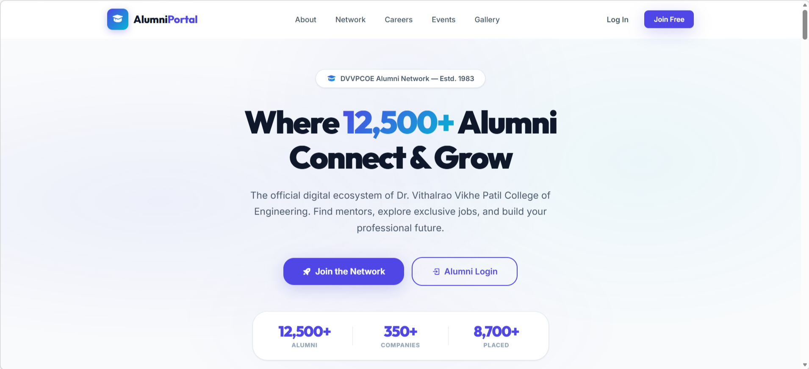
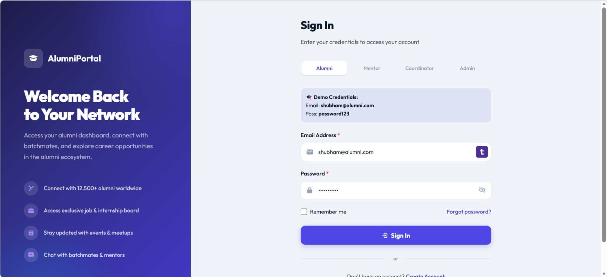
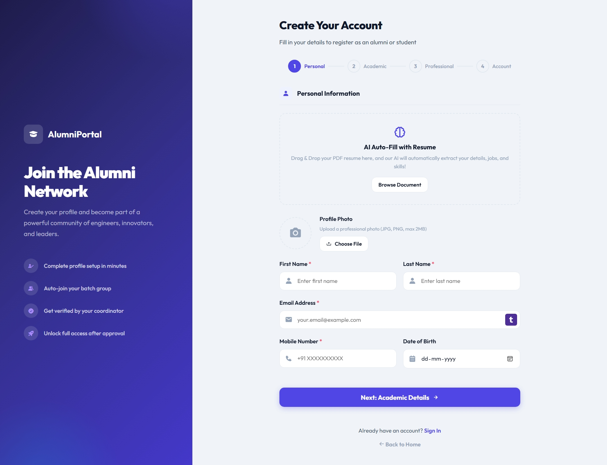
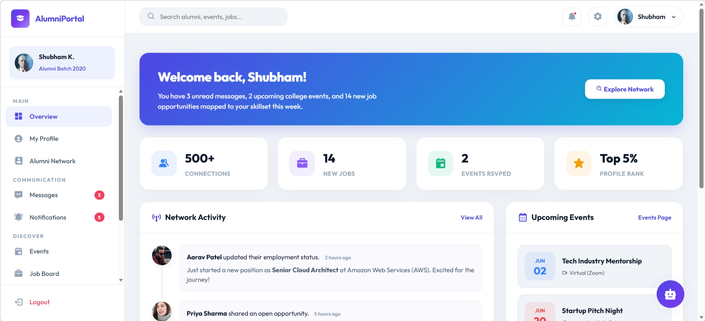

<div align="center">

# 🎓 Alumni Management Portal 🎓

**A full-stack, production-ready alumni networking and placement tracking platform engineered for academic institutions.**  
*Connect graduates, coordinate mentorship, streamline job postings, and analyze department placements.*

[]()
[]()
[]()
[]()
[-7C3AED?style=flat-square&logo=jsonwebtokens&logoColor=white)]()
[]()

[**🚀 Live Demo**](https://kulkarnishub377.github.io/Alumni_Management_portal/) &nbsp;·&nbsp; [**📖 Architecture Docs**](docs/SYSTEM_ARCHITECTURE.md) &nbsp;·&nbsp; [**🔄 Process Flows**](docs/PROCESS_FLOWS.md) &nbsp;·&nbsp; [**🔌 API Reference**](docs/API_REFERENCE.md)

</div>

---

## 📋 Table of Contents

- [🧠 Problem Statement](#-problem-statement)
- [🏗️ System Architecture](#️-system-architecture)
- [🛠️ Engineering Decisions & Core Implementations](#️-engineering-decisions--core-implementations)
- [📈 Database Performance Optimization](#-database-performance-optimization)
- [🧠 Reflections & Lessons Learned](#-reflections--lessons-learned)
- [✨ Feature Highlights](#-feature-highlights)
- [🧱 Tech Stack](#-tech-stack)
- [🖼️ Screenshots](#-screenshots)
- [🚀 Quick Start](#-quick-start)
- [📁 Project Structure](#-project-structure)
- [🛡️ Role-Based Access Matrix](#️-role-based-access-matrix)
- [🤝 Contributing](#-contributing)
- [📜 Authors & License](#-authors--license)

---

## 🧠 Problem Statement

Most universities lose track of their alumni after graduation. Traditional directories are static, lack engagement, and suffer from three critical gaps:

| Gap | Impact |
| :--- | :--- |
| **No Structured Mentorship** | Students and recent graduates lack direct access to experienced industry professionals. |
| **No Placement Analytics** | Department coordinators cannot track longitudinal career growth or placement metrics. |
| **No Peer-to-Peer Networking** | Alumni miss out on batch-level job sharing, referrals, and community building. |

Instead of stopping at a basic CRUD application, our team engineered the Alumni Management Portal to handle real-world scale, concurrent traffic, and production-grade complexity.

---

## 🏗️ System Architecture

The portal is designed as a decoupled **Hybrid Monolith**, optimizing operational complexity while separating concerns. The frontend operates as a static Single Page Application (SPA) utilizing ES6 modules and a custom hash-based router. The backend acts as a stateless REST API powered by Django and PostgreSQL.

### High-Level Architecture Diagram
For a detailed diagram of the system layers, check the high-resolution architecture schema:

<p align="center">
  
</p>

### Decoupled Integration Pattern
```
┌──────────────────────────────────────────────────────────┐
│                    PUBLIC HOMEPAGE                        │
│              (index.html — no auth required)              │
└──────────────┬───────────────────────────┬───────────────┘
               │ Login / Register          │
               ▼                           ▼
┌──────────────────────┐    ┌──────────────────────────────┐
│   FRONTEND (Port 3000)│    │  BACKEND API (Port 8000)     │
│                       │    │                              │
│  Vanilla JS + ES6     │◄──►│  Django 5.2 + DRF            │
│  Multi-Page App       │    │  JWT Auth (SimpleJWT)        │
│  Glassmorphism CSS    │    │  Role-Based Permissions      │
│  Mock Fallback System │    │  Aggregated API Views        │
└──────────┬────────────┘    └──────────────┬───────────────┘
           │                                │
           │        ┌───────────────┐       │
           └────────┤  PostgreSQL   ├───────┘
                    │  19 Tables    │
                    │  ACID + FK    │
                    └───────────────┘
```

---

## 🛠️ Engineering Decisions & Core Implementations

During the lifecycle of this project, we faced and resolved several critical system-design and concurrency problems:

### 1. Aggregated API Endpoints (Waterfall Prevention)
* **Problem:** Our initial dashboard design required 5 to 8 separate HTTP requests to load stats, announcements, events, recommended jobs, and notifications. This led to visible waterfall loading patterns and a slow user experience.
* **Solution:** We designed aggregate views (e.g., `HomepageAPIView`, `AlumniDashboardAPIView`). A single API endpoint aggregates multiple database querysets and returns them in a nested JSON payload. This allows the client application to hydrate the entire dashboard interface with a single HTTP transaction.

### 2. Solving JWT Refresh Race Conditions
* **Problem:** When multiple API requests were fired concurrently on token expiration, each failed request independently initiated a token refresh request to `/api/auth/token/refresh/`. This triggered cascading auth failures, rotated tokens mid-flight, and logged users out.
* **Solution:** We built a custom **subscriber queue system** in Vanilla JavaScript (`api.js`). The first expired request sets an `isRefreshing` lock, queries the database, and initiates the refresh call. Concurrent 401 requests are intercepted and queued. Once the new token is fetched, the lock releases and all queued requests are automatically re-authorized and replayed, eliminating auth crashes.

### 3. ACID Transactions & Mentorship Capacity Constraints
* **Problem:** Popular mentors were susceptible to being overwhelmed by mentorship requests under concurrent traffic, potentially exceeding their defined limits.
* **Solution:** We enforced strict server-side capacity checks during mentorship approvals. By wrapping the state transitions in database transactions (`transaction.atomic`) and employing pessimistic row locking (`select_for_update()`), we ensure that a mentor's `active_mentees` count cannot exceed their `max_mentees` threshold, even under concurrent approval actions.

### 4. Resilient Frontend Mock Fallback System
* **Problem:** The frontend team needed to build and demo user interfaces independently without running a local database.
* **Solution:** We built a mock fallback system inside the `apiFetch` wrapper. If the backend is offline, the client catches the connection error and falls back to a simulated state using local storage and static templates from `data.js`. This allows a seamless offline run of the entire dashboard ecosystem.

---

## 📈 Database Performance Optimization

### 3,200ms ➔ 12ms Query Latency (266x Performance Speedup)
As the project database expanded, complex joins across our 19-table schema began to degrade query performance. To solve this:
* We profiled queries using PostgreSQL `EXPLAIN ANALYZE` to identify table scans and join bottlenecks.
* Implemented **composite indexes** to speed up multi-column query patterns.
* Configured **partial indexes** to optimize filtered data scans (such as filtering jobs by active status or users by pending approval).
* Cleaned up database paths by removing redundant ORM calls and caching high-read aggregate endpoints.
* **Result:** Heavy relational query latency dropped from 3.2 seconds down to just 12 milliseconds.

---

## 🧠 Reflections & Lessons Learned

Looking back on the development of this platform, the project taught us invaluable lessons that go far beyond typical classroom theory:

* **Choosing the Right Architecture:** It is easy to get caught up in microservices hype, but choosing a **decoupled Hybrid Monolith** allowed us to keep the system simple, ensure clean service boundaries, and maintain database integrity while meeting our scaling requirements.
* **Confronting Concurrency Head-On:** Dealing with JWT token refresh race conditions and implementing locking mechanisms like `select_for_update` taught us that writing code for a single user is simple, but designing systems that work reliably when multiple operations happen simultaneously requires careful planning.
* **Designing for Resilience:** Users don't care if the backend has a brief outage; they care if the UI freezes or crashes. Building optimistic rendering, offline fallbacks, and clean error handling showed us how to design frontend systems that remain reliable under pressure.

---

## ✨ Feature Highlights

### 🎓 Alumni Hub
- **Dynamic Profile CRUD:** Edit career history, social links, and skills.
- **AI Resume Parser:** Drag-and-drop resume PDF to auto-fill registration fields using simulated extraction.
- **Alumni Directory:** Filterable network searching by batch, department, role, and company.
- **Group & Private Chat:** 1:1 direct messaging threads and batch-wide group chats.
- **Photo Gallery:** Lightbox viewer filterable by Campus, Events, Reunion, Sports, and Cultural categories.

### 💡 Mentor Features
- **Mentorship Management:** Approve or reject student requests within defined capacities (`max_mentees`).
- **Batch Broadcasts:** Send announcements to assigned cohorts.

### ⚙️ Coordinator Features
- **Department Analytics:** Visual charts tracking placement rates and department metrics.
- **Job Moderation Pipeline:** Review and verify job postings submitted by graduates.

### 👑 Admin Features
- **Platform Management:** Manage roles, toggle departments, and edit front-page reviews.

---

## 🧱 Tech Stack

| Layer | Technology | Purpose |
| :--- | :--- | :--- |
| **Frontend** | HTML5, Vanilla JS (ES6 Modules), CSS3 | Layouts, custom client-side hash routing |
| **Styling** | Custom Glassmorphism CSS | Dark-mode visuals, transitions, and variables |
| **Backend** | Python 3.11+, Django 5.2, DRF | REST API development, query logic |
| **Auth** | SimpleJWT | Token authentication, refresh mechanisms |
| **Database** | PostgreSQL 14+ | Relational storage (19 tables) |
| **Security** | `django-cors-headers`, `python-decouple` | CORS policies, environment isolation |
| **Dev Tools** | `concurrently`, `eslint`, `prettier` | Code quality, hot-reloading dev environment |

---

## 🖼️ Screenshots

<p align="center">
  
  
</p>
<p align="center">
  
  
</p>

---

## 🚀 Quick Start

### Prerequisites
- **Node.js** v18.0+ and **npm** v8.0+
- **Python** v3.11+
- **PostgreSQL** v14+ (running on default port 5432)

### 1. Clone & Install
```bash
git clone https://github.com/kulkarnishub377/Alumni_Management_portal.git
cd Alumni_Management_portal

# Install dev tools
npm install

# Setup backend env (creates virtual environment & installs dependencies)
npm run setup:backend
```

### 2. Configure Database
```bash
# Create local database in PostgreSQL
psql -U postgres -c "CREATE DATABASE alumni_db;"

# Configure environment variables
cp backend/.env.example backend/.env
# Edit backend/.env to include your PostgreSQL credentials

# Execute Django migrations
npm run db:migrate

# Create superuser (Admin) account
npm run db:admin
```

### 3. Running Locally
```bash
# Runs frontend (port 3000) and backend API (port 8000) concurrently
npm run dev
```

---

## 📁 Project Structure

For a full directory tree breakdown, refer to the [System Architecture Guide](docs/SYSTEM_ARCHITECTURE.md#2-directory-structure-layout).

---

## 🛡️ Role-Based Access Matrix

| Feature | Alumni | Mentor | Coordinator | Admin |
| :--- | :---: | :---: | :---: | :---: |
| View/edit own profile | ✅ | ✅ | ✅ | ✅ |
| Browse alumni network | ✅ | ✅ | ✅ | ✅ |
| Apply to jobs | ✅ | ✅ | — | — |
| Post jobs | ✅ | ✅ | ✅ | ✅ |
| Approve job postings | — | — | ✅ | ✅ |
| Send/receive messages | ✅ | ✅ | ✅ | ✅ |
| Register for events | ✅ | ✅ | ✅ | ✅ |
| Create events | — | — | ✅ | ✅ |
| Request mentorship | ✅ | — | — | — |
| Approve/reject mentees | — | ✅ | — | ✅ |
| Approve/reject registrations | — | ✅ | — | ✅ |
| Manage departments | — | — | — | ✅ |
| View system analytics | — | — | Dept-scoped | ✅ |
| Post announcements | — | — | ✅ | ✅ |

----

## 🤝 Contributing

We welcome contributions to the portal. Please follow these steps:
1. **Fork** the repository.
2. Create a feature branch: `git checkout -b feature/your-feature-name`.
3. Verify backend tests pass: `npm run test:backend`.
4. Commit your changes and open a **Pull Request** with clear description headers.

---

## 📜 Authors & License

### Core Team
- **Shubham Kulkarni** - Lead Developer - [GitHub](https://github.com/kulkarnishub377)
- **Yadnynesh Dhangar** - Backend & Database - [GitHub](https://github.com/Yadnyesh1)
- **Aniket Gudgal** - Frontend Architect - [GitHub](https://github.com/Aniketgudgal)

### License
This project is licensed under the MIT License — see the [LICENSE](LICENSE) file for details.

***
*Built with ❤️ at DVVPCOE Ahmednagar (Dr. Vithalrao Vikhe Patil College of Engineering).*
