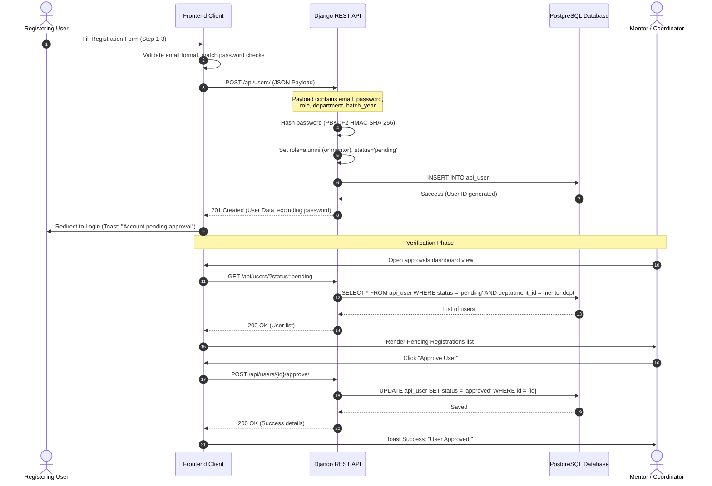
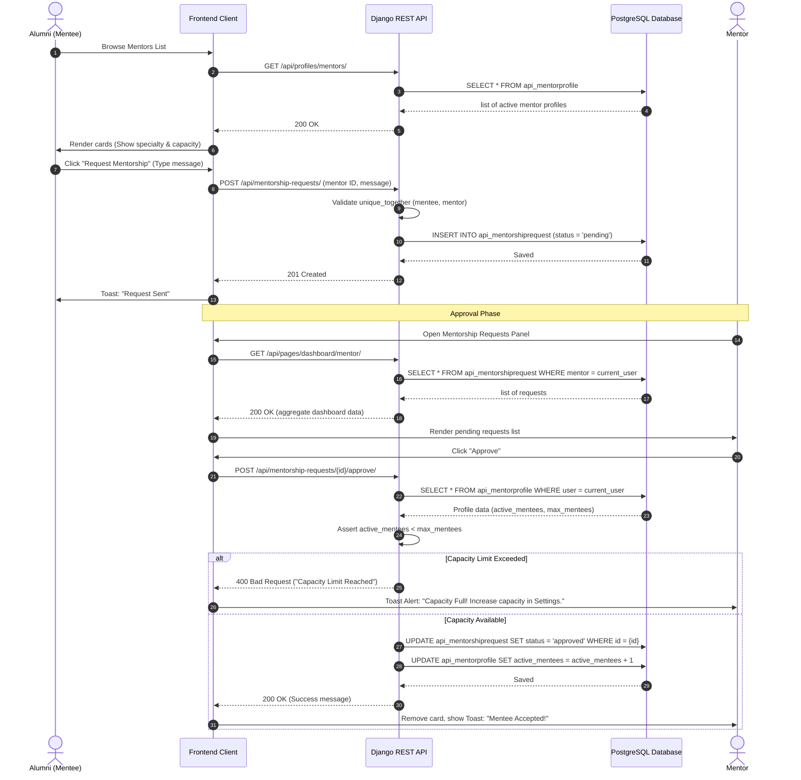
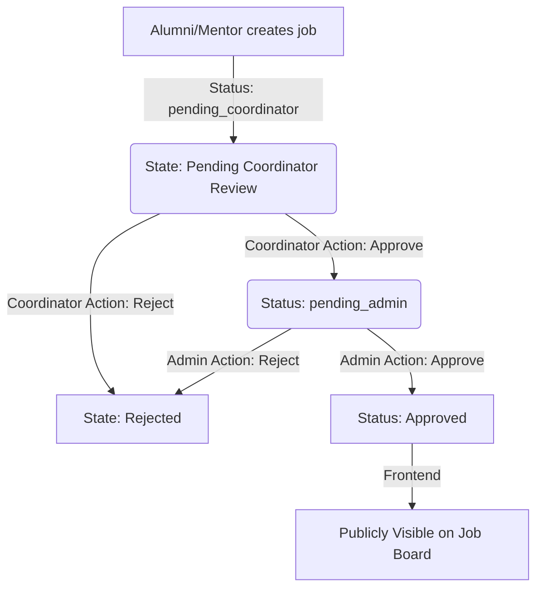
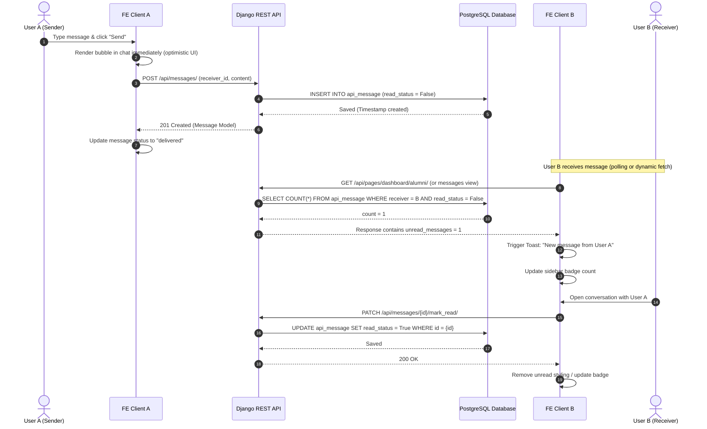
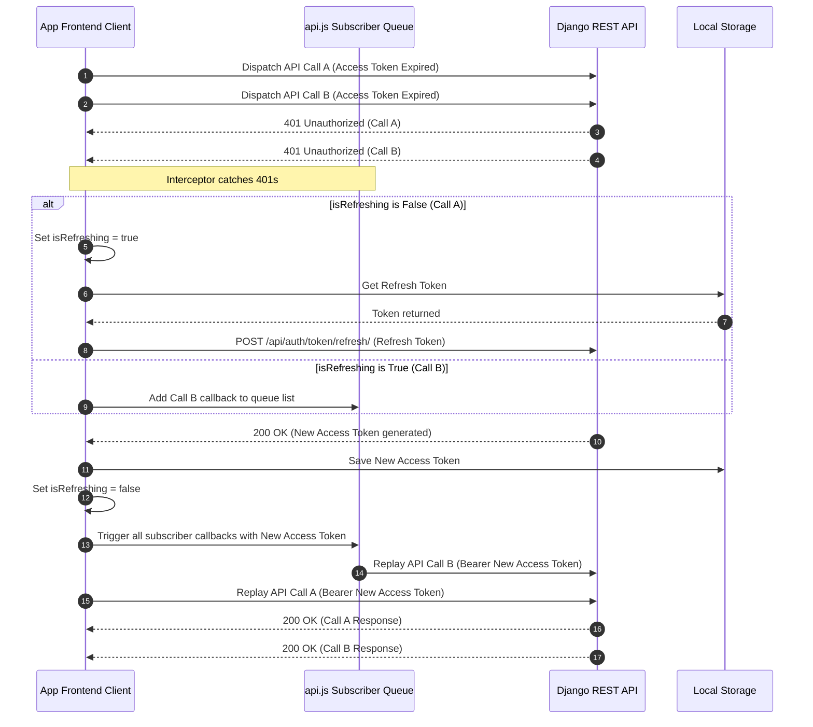

# 🔄 Process Flows & Sequence Diagrams

This document outlines the core transactional workflows of the Alumni Management Portal. It details the interactions between Users, the Frontend Client, the Backend REST API, and the PostgreSQL database.

---

## 1. User Registration & Verification Flow

A new user cannot access private areas immediately. They are saved with a `pending` status and must be approved by a Mentor or Coordinator associated with their registered department.

### Detailed Execution Steps:
1.  **Form Input:** The user fills personal details in Step 1, academic details in Step 2, and professional details in Step 3. The frontend validates fields locally.
2.  **API Dispatch:** The client submits a POST request to `/api/users/` containing the registration payload.
3.  **Hashing & Defaulting:** The Django backend intercepts the payload. The serializer invokes hashing on the password field and defaults the user's `status` to `pending` and `is_active` to `True`.
4.  **Database Commit:** An SQL insert query is issued to the `api_user` table.
5.  **Redirect:** The client receives a `201 Created` status code and redirects the user to `login.html`, notifying them that their registration is pending review.
6.  **Admin Portal Query:** A Mentor or Coordinator logs in and visits the Approvals Panel. The client issues a query to `/api/users/?status=pending`.
7.  **Approval Execution:** The reviewer clicks "Approve". The client dispatches a POST request to `/api/users/{id}/approve/`. The database updates the target row's status column to `approved`.

---

## 2. Mentorship Request & Capacity Constraints

Alumni can request mentorship from registered Mentors. The mentor has a capacity constraint (`max_mentees`) that is validated server-side.

### Detailed Execution Steps:
1.  **Browse Mentors:** The alumni navigates to the mentorship directory, initiating a fetch to `/api/profiles/mentors/`.
2.  **Request Creation:** The alumni clicks "Request Mentorship" on a mentor card. This dispatches a POST request to `/api/mentorship-requests/` with the mentor's user ID and a text introduction message.
3.  **Integrity Validation:** The DRF serializer verifies that this specific `(mentee, mentor)` relationship doesn't already exist in the database to prevent duplicate requests.
4.  **Database Commit:** The backend saves the request to the `api_mentorshiprequest` table with `status = 'pending'`.
5.  **Mentor Interface:** When the mentor opens their dashboard, the client requests the aggregate `/api/pages/dashboard/mentor/` endpoint, displaying pending requests.
6.  **Approval Check:** The mentor approves. The server performs a check: it fetches the mentor's profile records and compares the `active_mentees` count against `max_mentees`.
7.  **Database Update:** If capacity is available, the request status shifts to `approved`, and the mentor's profile `active_mentees` counter increments by 1. Otherwise, a `400 Bad Request` is returned.

---

## 3. Job Posting Approval Pipeline

To ensure the job board remains spam-free, job postings go through a multi-step approval pipeline.

### Flow Details:
1.  **Job Creation:** An alumni or mentor posts a job. The API automatically sets `status = 'pending_coordinator'`.
2.  **First Gate (Coordinator):** The coordinator reviews job listings posted by alumni within their own department. They call `POST /api/jobs/{id}/approve_job/`, which shifts the job state to `pending_admin`.
3.  **Second Gate (Admin):** The global admin reviews the job. Approving it changes the status to `approved`, making it public.
4.  **Rejection:** Either the coordinator or the admin can reject the job at any stage, moving the state directly to `rejected`.

---

## 4. Messaging & Toast Notification Dispatch

The platform implements 1:1 messaging. The client updates conversation interfaces dynamically.

### Detailed Execution Steps:
1.  **Optimistic UI Update:** When User A types a message and clicks send, the frontend immediately appends a chat bubble to the UI.
2.  **API Dispatch:** The client dispatches a POST request to `/api/messages/` with the receiver's ID and the message body.
3.  **Database Commit:** The message is saved to the `api_message` table with `read_status = False`.
4.  **Poll / Fetch Interception:** User B's dashboard fetches updates from `/api/pages/dashboard/{role}/`. The API returns `unread_messages_count = 1` based on the database query.
5.  **Toast Notification:** The receiver's client triggers a Toast notification using the `showToast()` helper.
6.  **Marking Read:** When User B opens the chat thread, a PATCH request is dispatched to `/api/messages/{id}/mark_read/`. The database updates `read_status` to `True`.

---

## 5. Token Expiry & Race-Condition Queue Replay Flow

When multiple API requests occur concurrently and the access token has expired, a subscriber pattern prevents redundant refresh requests.

### Detailed Execution Steps:
1.  **Simultaneous Calls:** The client makes two parallel requests (e.g. fetching announcements and jobs). The access token has expired.
2.  **401 Catching:** The server returns `401 Unauthorized` for both requests. The `apiFetch()` interceptor catches the errors.
3.  **Refresh Lock:** The first handler evaluates `isRefreshing` which is `false`. It sets `isRefreshing = true` and dispatches a POST to `/api/auth/token/refresh/`.
4.  **Subscriber Enrollment:** The second request catches a 401, sees `isRefreshing` is `true`, and queues its resolve function in `refreshSubscribers` rather than sending a redundant refresh request.
5.  **Token Rotation:** The API validates the refresh token, writes the new access token to the database, and returns it.
6.  **Queue Execution:** The client stores the new token in `localStorage`, resets `isRefreshing` to `false`, and executes all queued callbacks. Both requests are replayed and complete successfully.
