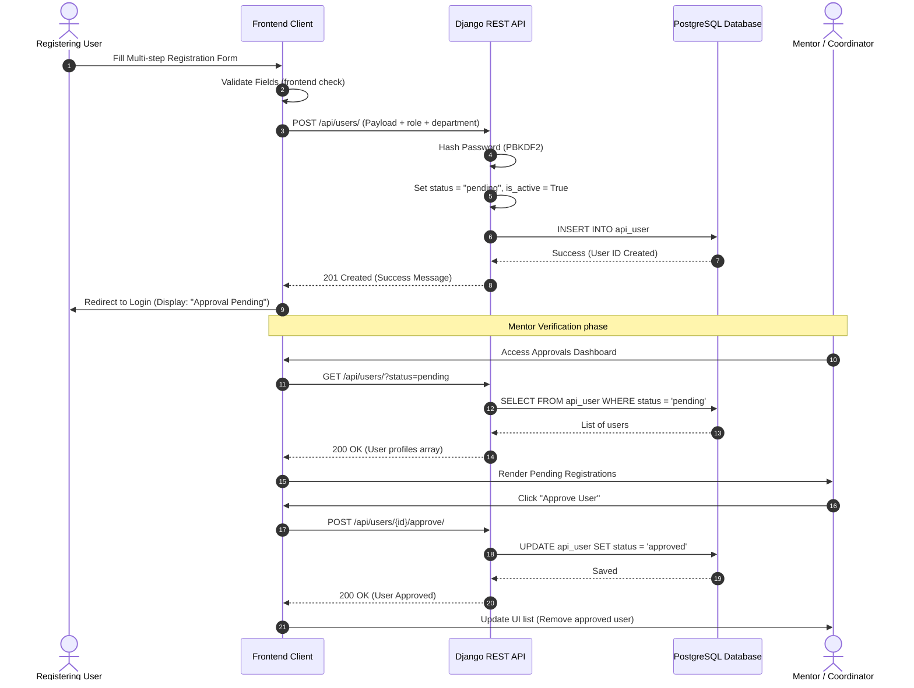
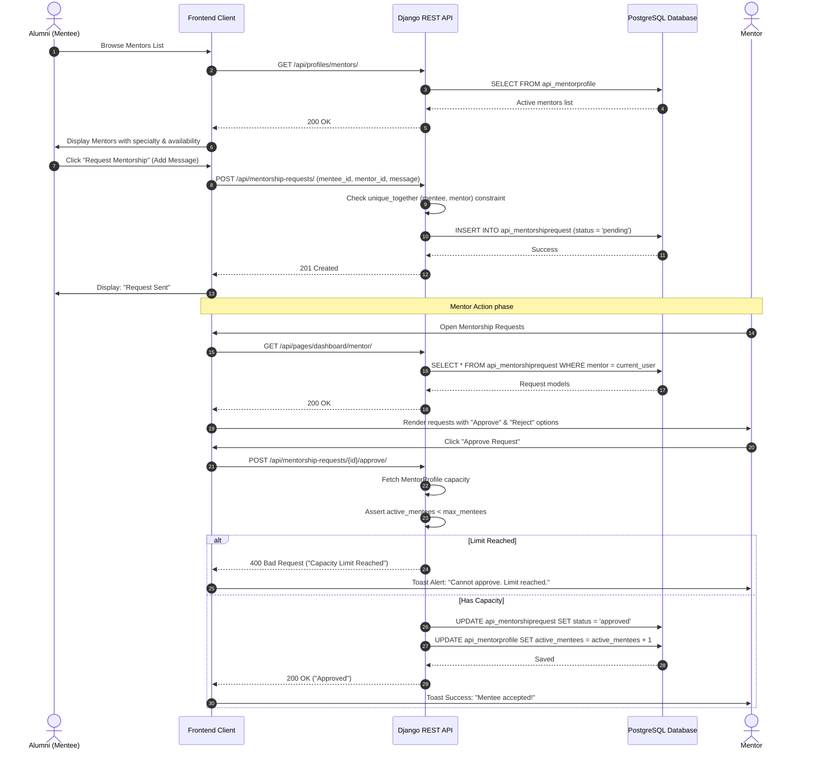
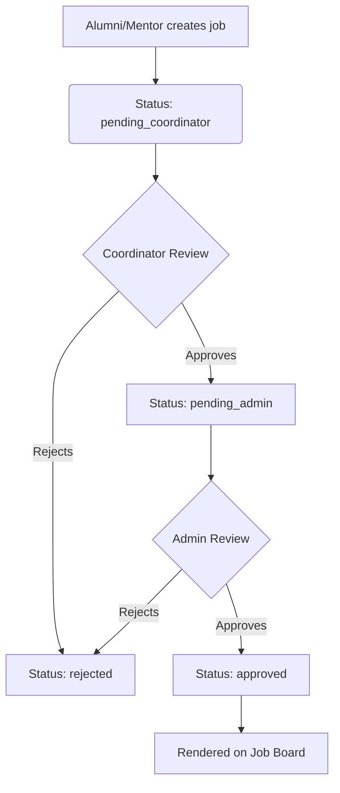
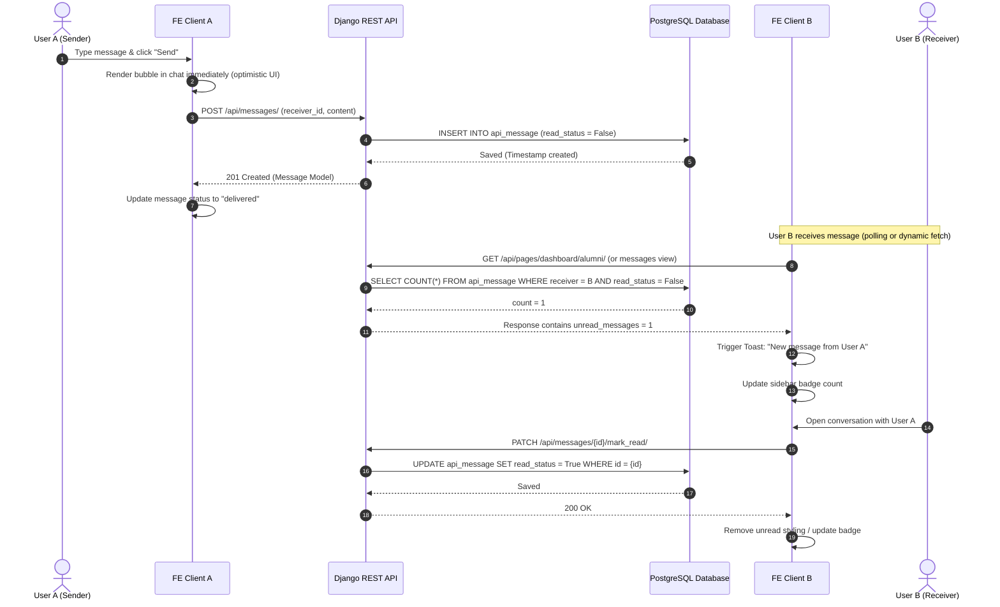

# 🔄 Process Flows & Sequence Diagrams

This document outlines the core transactional workflows of the Alumni Management Portal, visualizing the interactions between Users, the Frontend App, the Backend REST API, and the PostgreSQL database.

---

## 1. User Registration & Verification Flow

A new user cannot access the system immediately upon registration. They must go through a validation process where their academic details are approved by a Mentor or Coordinator of their respective department.

---

## 2. Mentorship Request & Assignment Pipeline

Alumni can request mentorship from registered and verified Mentors. The mentor has a capacity constraint (`max_mentees`) that is validated server-side.

---

## 3. Job Posting Approval Pipeline

To ensure the job board remains spam-free, job postings go through a multi-step approval pipeline.

### Flow Details:
1. **Creation:** An alumni or mentor posts a job. The API automatically sets `status = 'pending_coordinator'`.
2. **First Gate (Coordinator):** The coordinator reviews job listings posted by alumni within their own department. They call `POST /api/jobs/{id}/approve_job/`, which shifts the job state to `pending_admin`.
3. **Second Gate (Admin):** The global admin reviews the job. Approving it changes the status to `approved`, making it public.
4. **Rejection:** Either the coordinator or the admin can reject the job at any stage, moving the state directly to `rejected`.

---

## 4. Messaging & Toast Notification Dispatch

The platform implements 1:1 messaging. The client updates conversation interfaces dynamically.

